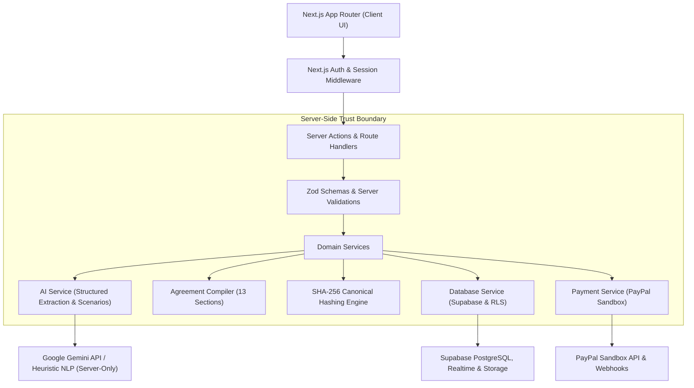
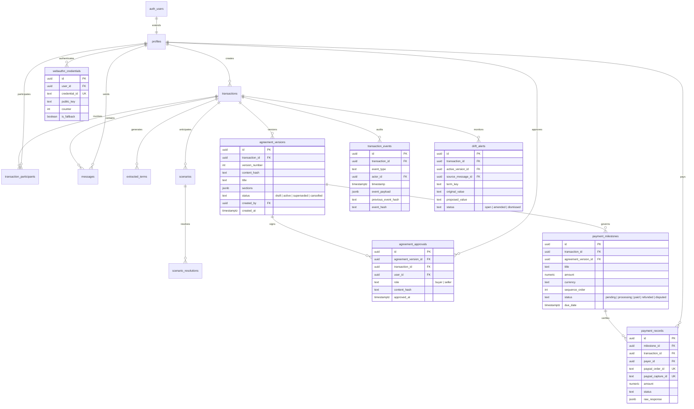

# PACT Architecture & System Design Document

**Platform:** PACT (Predict. Agree. Protect.) — AI-Powered Transaction Assurance for Custom Commerce  
**Version:** 0.7.0  
**Status:** Phase 6 Complete (Core PACT Architecture Complete)

---

## 1. Architectural Overview

PACT provides a structured trust framework for custom commerce transactions. Unlike standard e-commerce carts with fixed catalog items, custom commerce transactions (freelance deliverables, bespoke manufacturing, specialized consulting) involve emergent scope, variable milestones, and potential disputes.

PACT bridges conversational negotiation and contract execution through:
1. **Server-Side AI Assistance:** Structured extraction of agreed terms from conversation logs with full source message traceability, plus proactive complication anticipation.
2. **Predictive Scenario & Contingency Engine:** Proactive generation of multi-step causal consequence chains (material stockouts, timeline slippages, revision ambiguities) with dual-approval contingency resolutions and a 0-100% scenario coverage metric.
3. **13-Section Grouped Agreement Compiler & Immutable SHA-256 Versioning Engine:** Synthesizes confirmed terms and resolved scenarios into a formal 13-section contract. Every amendment produces a deterministically serialized SHA-256 version fingerprint. Both parties must sign the identical hash before activation.
4. **Verified PayPal Milestone Disbursements:** Milestone funding and releases are validated exclusively through server-side verified PayPal events (webhooks and API captures), clearly distinct from legal escrow.
5. **Cryptographic Assurance & Evidence Preservation:** Cryptographic hashing of evidence records and WebAuthn/passkey mutual signatures without storing raw biometric data.



---

## 2. Database Architecture & Row-Level Security (RLS)

PostgreSQL schema migrations:
- `supabase/migrations/20261111000000_init_schema.sql` (Profiles, Transactions, Participants, Messages)
- `supabase/migrations/20261111000001_extracted_terms.sql` (Extracted Terms & Source Citations)
- `supabase/migrations/20261111000002_scenarios.sql` (Predictive Scenarios & Contingency Resolutions)
- `supabase/migrations/20261111000003_agreements.sql` (Immutable Agreement Versions & Mutual Approvals)
- `supabase/migrations/20261111000004_payments.sql` (PayPal Payment Milestones & Server Verification Records)
- `supabase/migrations/20261111000005_evidence_vault_and_passkeys.sql` (WebAuthn Passkeys, Hash-Chained Ledger & Drift Alerts)



### Row Level Security (RLS) Invariants
- **`agreement_versions`**: Accessible only by participants in that transaction. Modifying an agreement produces version $N+1$ (`version_number` increments) rather than mutating existing versions in place (Rule 9).
- **`agreement_approvals`**: Readable only by transaction participants. Users can only insert approval rows for their own authenticated ID (`user_id = auth.uid()`). An agreement version activates and the transaction locks only when both a buyer approval and a seller approval match the identical canonical hash (Rule 10).
- **`payment_milestones` & `payment_records`**: Restricted via RLS to verified transaction participants (`payer_id = auth.uid()` on inserts). PayPal order creation verifies buyer role and mutually `active` agreement version; milestone `paid` transitions occur exclusively after server-side PayPal capture verification (`status === 'COMPLETED'`, Rule 11).
- **`webauthn_credentials`, `transaction_events` & `drift_alerts`**: `webauthn_credentials` strictly scopes all operations to `user_id = auth.uid()` and stores only public keys/counters (Rule 13). `transaction_events` is append-only (`actor_id = auth.uid()` + participant check) with SHA-256 hash chaining verified via `verifyLedgerIntegrity`. `drift_alerts` enforces participant RLS and never mutates locked agreements silently (Rule 7 & 9).

---

## 3. Canonical Serialization & Cryptographic Hashing Engine

Located at `lib/agreement/hash.ts`:
- **Deterministic Key-Sorting (`canonicalizeValue`):** Recursively key-sorts all nested object attributes so key ordering differences never alter the hash.
- **SHA-256 Digest (`computeCanonicalAgreementHash`):** Hashes the canonical UTF-8 JSON payload to a 64-character hexadecimal digest.
- **Constant-Time Verification (`verifyAgreementIntegrity`):** Uses `crypto.timingSafeEqual` over buffers to prevent timing side-channel attacks during signature or hash matching.

---

## 4. The 13 Standard PACT Contract Sections

Located at `services/agreement/builder.ts`:
1. **Scope of Work & Deliverables:** Primary commission specifications with confirmed chat citations.
2. **Technical & Material Standards:** Dimensions, fabric/hardware grades, craftsmanship tolerances.
3. **Financial Terms & Milestone Schedule:** Total contracted value, currency, payment schedules.
4. **Delivery Schedule & Deadlines:** Target completion dates, transit carrier tracking requirements.
5. **Inspection & Acceptance Testing:** 48-hour inspection countdown and Evidence Vault proof verification.
6. **Contingency Protocol (Timeline Delays):** Agreed milestone extensions and courier upgrades.
7. **Contingency Protocol (Material Stockouts):** Verified substitute swatch approvals and cost absorption.
8. **Contingency Protocol (Scope & Revisions):** Review iterations, change order rates, and labor adjustment schedules.
9. **Contingency Protocol (Quality Variances):** Alteration provisions and final settlement discounts.
10. **Cancellation & Mutual Settlement:** Sunk material cost calculations and equitable deposit refunds.
11. **Intellectual Property & Commercial Rights:** Title transfer upon full settlement; seller portfolio rights.
12. **Warranties & Representation:** Material authenticity guarantees, non-infringement warranties.
13. **Milestone Disbursement & Statutory Non-Escrow Compliance Notice (Rule 12):** Explicit notice that payments are coordinated via PayPal Developer Sandbox and do not constitute legal escrow.

---

## 5. Modular Application Structure

```
pact/
├── app/                              # Next.js App Router
│   ├── (auth)/                       # Authentication Route Group
│   │   ├── layout.tsx                # Centered auth branding shell
│   │   ├── login/page.tsx            # Email/Password sign-in
│   │   └── signup/page.tsx           # Registration with role selection
│   ├── (dashboard)/                  # Authenticated Route Group
│   │   ├── layout.tsx                # Top navigation navbar, user profile, logout
│   │   ├── dashboard/page.tsx        # Transaction cards hub & empty state
│   │   └── transactions/
│   │       ├── create/page.tsx       # Transaction creation form & invite generator
│   │       ├── join/page.tsx         # Join transaction via 8-char invite code
│   │       └── [id]/page.tsx         # 5-Pillar Transaction Workspace
│   ├── actions/                      # Server Actions
│   │   ├── auth.ts                   # signIn, signUp, signOutAction
│   │   └── transaction.ts            # createTransactionAction, joinTransactionAction
│   ├── api/                          # API Route Handlers
│   │   ├── agreements/
│   │   │   ├── approve/route.ts            # Dual approval state machine (passkey + session), lock & milestone sync
│   │   │   └── compile/route.ts            # 13-section compiler & version incrementing
│   │   ├── ai/
│   │   │   ├── detect-drift/route.ts       # Post-lock agreement drift detection & amendment builder
│   │   │   ├── extract-terms/route.ts      # Server-side AI term extraction & persistence
│   │   │   └── generate-scenarios/route.ts # AI & heuristic scenario generator
│   │   ├── auth/
│   │   │   └── passkey/route.ts            # WebAuthn / ECDSA credential registration & challenge verification
│   │   ├── health/route.ts                 # System health-check endpoint
│   │   ├── messages/send/route.ts          # Chat message persistence, extraction & drift detection triggers
│   │   ├── payments/
│   │   │   ├── capture-order/route.ts      # Server-side PayPal capture verification & ledger update
│   │   │   ├── create-order/route.ts       # Buyer-authorized PayPal Sandbox order creation
│   │   │   └── sync-milestones/route.ts    # Syncs milestone schedule from active agreement
│   │   ├── scenarios/resolve/route.ts      # Contingency proposal & dual approval endpoint
│   │   ├── terms/confirm/route.ts          # Term confirmation/rejection action
│   │   └── vault/
│   │       └── verify-integrity/route.ts   # Full hash-chain ledger audit endpoint
│   ├── globals.css                   # Custom theme tokens & Tailwind v4
│   ├── layout.tsx                    # Root typography & viewport metadata
│   └── page.tsx                      # Landing page & feature preview
├── components/                       # UI Components
│   ├── ui/                           # Atomic Reusable UI Primitives (Button, Card, Input, Badge, Dialog)
│   └── workspace/                    # Workspace Sub-Components
│       ├── ConversationTab.tsx       # Live chat stream with Realtime updates
│       ├── ExtractedTermsPanel.tsx   # Categorized review panel with confirm/reject actions
│       ├── ScenariosTab.tsx          # Coverage meter, filters, and scenarios feed
│       ├── ScenarioCard.tsx          # Card with consequence step stepper & resolution pill
│       ├── ScenarioResolutionModal.tsx # Preset selector, custom form, and dual-signing flow
│       ├── AgreementTab.tsx          # Dual passkey/session approval cards, hash display, version selector
│       ├── AgreementViewer.tsx       # 13-section expandable accordion with origin badges
│       ├── PasskeySignButton.tsx     # WebAuthn biometric passkey & WebCrypto ECDSA fallback signer
│       ├── VersionDiffViewer.tsx     # Version diff visualizer (added, modified, unchanged)
│       ├── PayPalCheckoutButton.tsx  # PayPal Smart Buttons SDK loader & Sandbox Simulation fallback
│       ├── MilestoneCard.tsx         # Staged milestone status badge, amount & capture ID display
│       ├── PaymentsTab.tsx           # Financial summary, Rule 12 compliance notice & payment ledger
│       ├── VaultTab.tsx              # Hash-chain event timeline, integrity audit & JSON proof export
│       └── DisputeModal.tsx          # Neutral dispute reconstruction summary & claim mismatch view
├── features/transactions/            # Transaction Feature Aggregates
│   └── WorkspaceTabs.tsx             # 5-Pillar workspace shell & floating Drift Alert Banner
├── lib/
│   ├── agreement/
│   │   └── hash.ts                   # Canonical serialization & SHA-256 hashing engine
│   ├── auth/
│   │   └── passkeys.ts               # WebAuthn client helper & WebCrypto ECDSA fallback helper
│   ├── ledger/
│   │   └── events.ts                 # Hash-chained event logger & timingSafeEqual integrity verifier
│   ├── paypal/
│   │   └── client.ts                 # PayPal OAuth2, /v2/checkout/orders create & capture client
│   ├── scenarios/
│   │   └── coverage.ts               # Scenario coverage score engine (0-100%)
│   ├── supabase/                     # Supabase Client Infrastructure
│   │   ├── client.ts                 # Browser client (createBrowserClient)
│   │   ├── server.ts                 # Server client with cookies (createServerClient)
│   │   └── middleware.ts             # Session refresh & route guard helper
│   ├── constants.ts                  # Domain statuses, roles, classifications
│   └── utils.ts                      # Zero-dependency class composer (cn)
├── middleware.ts                     # Root Next.js route protection proxy
├── services/                         # Core Backend Services & Integration Boundaries
│   ├── agreement/
│   │   └── builder.ts                # 13-section contract builder & version diffing
│   ├── ai/
│   │   ├── ai.service.ts             # AI interface contract
│   │   ├── drift.ts                  # Post-lock agreement drift detection (Gemini + heuristic fallback)
│   │   ├── extraction.ts             # Gemini 2.5 Flash & heuristic extraction engine
│   │   └── scenarios.ts              # Predictive scenario engine & deterministic fallback
│   ├── database/db.service.ts        # Supabase database query service
│   ├── payment/
│   │   ├── milestones.ts             # Agreement-to-milestone schedule builder & DB synchronizer
│   │   └── paypal.service.ts         # PayPal service compatibility contracts
│   └── auth/auth.service.ts          # Session validation & server SPKI passkey verification
├── types/                            # Canonical TypeScript Domain Interfaces
│   ├── database.ts                   # PostgreSQL schema row definitions
│   ├── transaction.ts                # TransactionItem, Participant, Summary
│   ├── term.ts                       # ExtractedTerm, TermCategory, Classification
│   ├── scenario.ts                   # PredictiveScenario, Resolution, CoverageMetrics
│   ├── agreement.ts                  # AgreementVersion, Section, Approval, Diff
│   ├── user.ts                       # UserProfile and Actor roles
│   ├── milestone.ts                  # Milestone payment lifecycle
│   ├── payment.ts                    # PayPal Sandbox milestones, records, orders & captures
│   ├── passkey.ts                    # WebAuthn credential, ECDSA fallback & verification modes
│   ├── vault.ts                      # TransactionEvent, LedgerIntegrityReport, DriftAlert & ProofPackage
│   └── ai.ts                         # Extraction & risk contracts
├── validations/                      # Zod Validation Schemas
│   ├── auth.ts                       # Login & Signup schemas
│   ├── transaction.ts                # Create & Join transaction schemas
│   ├── term.ts                       # Message send, term confirmation & extraction schemas
│   ├── scenario.ts                   # Scenario generation, proposal & approval schemas
│   ├── agreement.ts                  # Agreement compile, approve (+ passkey metadata) & compare schemas
│   ├── agreement.schema.ts           # Legacy validation compatibility
│   ├── payment.ts                    # PayPal create-order, capture-order & milestone sync schemas
│   ├── payment.schema.ts             # Legacy payment validation compatibility
│   ├── milestone.schema.ts           # Legacy milestone structure validation
│   └── vault.ts                      # Passkey, drift detection, ledger audit & dispute schemas
└── supabase/
    └── migrations/
        ├── 20261111000000_init_schema.sql                  # Base profiles, transactions, participants, messages
        ├── 20261111000001_extracted_terms.sql              # Extracted terms table, citations, RLS
        ├── 20261111000002_scenarios.sql                    # Scenarios & contingency resolutions, RLS
        ├── 20261111000003_agreements.sql                   # Agreement versions, approvals, SHA-256 hashes, RLS
        ├── 20261111000004_payments.sql                     # Payment milestones, PayPal verification records, RLS
        └── 20261111000005_evidence_vault_and_passkeys.sql  # WebAuthn keys, hash-chained events & drift alerts, RLS
```

---

## 6. The 5 Pillars of the Transaction Workspace

Within `app/(dashboard)/transactions/[id]/page.tsx`, the workspace coordinates custom commerce across 5 specialized pillars:

1. **Conversation (Phase 2 - Complete):** Real-time negotiation chat stream where buyers and sellers discuss deliverables. Serves as raw evidence for AI extraction and triggers automatic drift checks once an agreement is locked.
2. **Scenarios (Phase 3 - Complete):** Anticipates commercial friction (timeline compression, scope creep, material stockouts, unstated acceptance criteria) with consequence step chains and dual-approval contingency protocols.
3. **Agreement (Phase 4 & 6 - Complete):** 13-section contract engine with canonical SHA-256 fingerprinting, WebAuthn biometric passkey + WebCrypto ECDSA fallback signing, dual mutual approval, and automatic version incrementing on amendment ($V_{n+1}$).
4. **Payments (Phase 5 - Complete):** PayPal Developer Sandbox staged milestone disbursement manager with buyer-only order initiation, server-verified order captures, Rule 12 non-escrow notice, and transaction verification ledger.
5. **Evidence Vault (Phase 6 - Complete):** Append-only SHA-256 hash-chained `transaction_events` ledger (`verifyLedgerIntegrity` audit, downloadable `.json` Proof of Agreement package, and neutral `DisputeModal` reconstruction) alongside the workspace-wide **Drift Alert Banner**.
